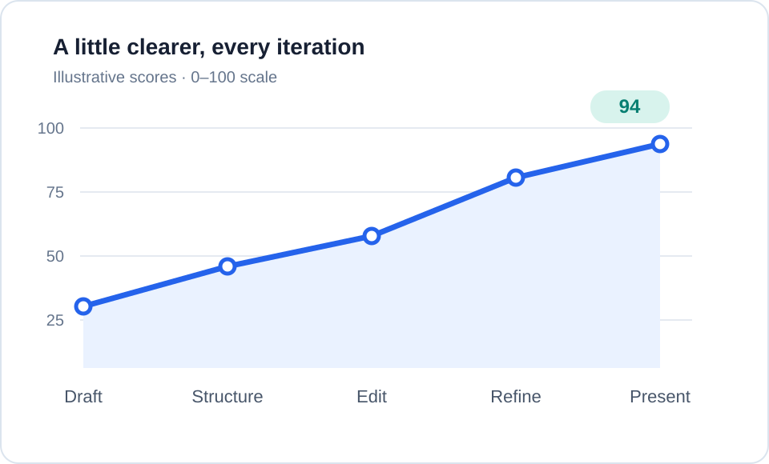
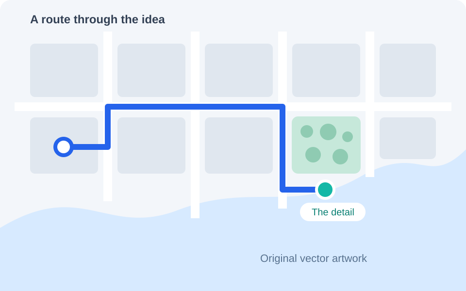

<!-- _layout: cols 5 4 -->

# Marpres
## A source you can read. A canvas you can shape.

:::: panel id=cover-message-panel align=left valign=center
::: box id=cover-headline font=48
Build the story.

Fine-tune the slide.
:::

::: box id=cover-description
Write Markdown, shape the layout, then present or export.
:::
::::

:::: panel id=cover-art-panel valign=center
::: figure id=cover-art

:::
::::

::: figure id=cover-brand position=absolute dx=1142 dy=20 width=98

:::

::: footer
A hands-on tour · 12 slides · one Markdown source
:::

---

<!-- _layout: cols 1 1 -->

# One deck. Two ways to work.

:::: panel id=workflow-source-panel align=left valign=center
::: box id=workflow-source-heading font=32
**Write the structure**
:::

::: box id=workflow-source-example font=25
```markdown
::: figure id=progress

:::

::: caption id=message
A little clearer, every iteration.
:::
```
:::

::: box id=workflow-source-note font=23
Readable text. Local images. Stable object IDs.
:::
::::

:::: panel id=workflow-canvas-panel valign=center
::: figure id=workflow-chart

:::

::: caption id=workflow-caption
A little clearer, every iteration.
:::

::: ref id=workflow-reference
Select, resize, crop, and format on the canvas.
:::
::::

::: footer
Try it · Select the chart, then use Show source to find its Markdown.
:::

---

<!-- _layout: cols 5 3 -->

# Give each element room to breathe

:::: panel id=weighted-figure-panel valign=center
::: figure id=weighted-chart

:::

::: caption id=weighted-caption
A clearer signal across five iterations.
:::

::: ref id=weighted-reference
Illustrative data · original SVG · independently editable source line
:::
::::

:::: panel id=weighted-message-panel align=left valign=center
::: box id=weighted-heading font=38
Figure.

Caption.

Reference.
:::

::: box id=weighted-description font=24
Three objects, each with its own position and style.

This slide uses weighted columns: **5 : 3**.
:::
::::

::: footer
Try it · Select each object separately. Shift-click to align a group.
:::

---

<!-- _layout: grid 2x3 1 1 1 / 1 1 -->

# Arrange a story in a grid

:::: panel id=grid-overview-panel row=1-2 col=1-2 valign=center
::: figure id=grid-overview

:::

::: caption id=grid-caption
One panel spans two rows and two columns.
:::
::::

:::: panel id=grid-rows-panel row=1 col=3 align=left valign=center
::: box id=grid-rows-number font=70 color=#2563eb
02
:::
::: box id=grid-rows-copy font=25
**Rows**

A large overview beside two smaller ideas.
:::
::::

:::: panel id=grid-columns-panel row=2 col=3 align=left valign=center
::: box id=grid-columns-number font=70 color=#0d9488
03
:::
::: box id=grid-columns-copy font=25
**Columns**

Use `row=1-2 col=1-2` for the spanning panel.
:::
::::

::: footer
Try it · Turn on full-slide Guides and Snap to refine spacing and alignment.
:::

---

<!-- _layout: cols 1 1 -->

# Focus the image. Keep the original.

:::: panel id=crop-original-panel valign=top
::: figure id=crop-original width=500

:::

::: caption id=crop-original-caption
Original · the complete route
:::

::: ref id=crop-original-reference
The SVG file stays unchanged.
:::
::::

:::: panel id=crop-detail-panel valign=top
::: figure id=crop-detail width=500 crop=42,18,50,64

:::

::: caption id=crop-detail-caption
Detail · a different visible frame
:::

::: ref id=crop-detail-reference
Crop, resize, and align the frame you can see.
:::
::::

::: footer
Try it · Double-click either image to crop. Enter applies; Escape cancels.
:::

---

<!-- _layout: cols 1 1 -->

# Choose where new content belongs

:::: panel id=insertion-flow-panel align=left
::: box id=insertion-flow-heading font=34
**Inside a panel**
:::

::: box id=insertion-flow-description
This text follows the column layout.

Choose **Insert into → Panel 1** to add text or an image here.

The new content inherits the panel’s space and alignment.
:::
::::

:::: panel id=insertion-free-panel align=left
::: box id=insertion-free-heading font=34
**Free on slide**
:::

::: box id=insertion-free-description
Choose **Free on slide** for a label, annotation, or callout.

Move it anywhere on the canvas.
:::
::::

::: shape id=insertion-callout-frame shape=rounded-rect dx=700 dy=375 width=470 height=155 fill=#eff6ff stroke=#93b5ee stroke_width=2 layer=-1
:::

::: box id=insertion-callout position=absolute dx=730 dy=412 width=410 font=30 align=center color=#1e3a8a
An independent callout,

right where you need it.
:::

::: footer
Try it · Change Insert into explicitly. Selecting an object does not change that choice.
:::

---

<!-- _layout: cols 1 1 -->

# Keep structure in Markdown

:::: panel id=markdown-text-panel align=left valign=center
::: box id=markdown-text
## Words with structure

- **Emphasis** for the main idea
- *A softer voice* for supporting detail
- `Inline code` for precise terms

```js
const story = ["idea", "evidence", "point"]
story.forEach(present)
```
:::
::::

:::: panel id=markdown-math-panel valign=center
::: box id=markdown-math-heading font=32 align=center
**Equations that stay readable**
:::

::: box id=markdown-equations
$$
\mathbf y = X\mathbf w + \mathbf b
$$

$$
X = \begin{pmatrix}
1 & 2 \\
3 & 4
\end{pmatrix}
$$
:::

::: box id=markdown-math-note font=23 align=center
Inline math works too: $y = wx + b$.
:::
::::

::: footer
Try it · Double-click a text object to edit. Use the formatting bar for local styling.
:::

---

# Build diagrams from editable parts

::: box id=diagram-introduction font=27
A simple process, made from separate shapes, arrows, and labels.
:::

::: shape id=diagram-draft-card shape=rounded-rect dx=100 dy=245 width=280 height=150 fill=#eff6ff stroke=#93b5ee stroke_width=2
:::
::: shape id=diagram-refine-card shape=rounded-rect dx=500 dy=245 width=280 height=150 fill=#e6f6f1 stroke=#86c8b5 stroke_width=2
:::
::: shape id=diagram-present-card shape=rounded-rect dx=900 dy=245 width=280 height=150 fill=#fff5e8 stroke=#efc18b stroke_width=2
:::
::: shape id=diagram-first-arrow shape=arrow dx=401 dy=304 width=78 height=30 stroke=#64748b stroke_width=4
:::
::: shape id=diagram-second-arrow shape=arrow dx=801 dy=304 width=78 height=30 stroke=#64748b stroke_width=4
:::

::: box id=diagram-draft-label position=absolute dx=130 dy=286 width=220 font=32 align=center color=#1e3a8a
**Draft**
:::
::: box id=diagram-refine-label position=absolute dx=530 dy=286 width=220 font=32 align=center color=#065f46
**Refine**
:::
::: box id=diagram-present-label position=absolute dx=930 dy=286 width=220 font=32 align=center color=#92400e
**Present**
:::

::: box id=diagram-description position=absolute dx=180 dy=470 width=920 font=27 align=center
Select several objects to align or distribute them.

Adjust fill, stroke, rotation, and layer independently.
:::

::: footer
Try it · Insert a shape from the gallery, then connect it with an arrow.
:::

---

<!-- _layout: cols 1 1 1 -->

# Reveal the story, one step at a time

:::: panel id=reveal-context-panel stage=0 align=left valign=center
::: box id=reveal-context-number font=76 color=#2563eb
01
:::
::: box id=reveal-context-copy
## Set the context

Start with one clear question.
:::
::::

:::: panel id=reveal-evidence-panel stage=1 align=left valign=center
::: box id=reveal-evidence-number font=76 color=#0d9488
02
:::
::: box id=reveal-evidence-copy
## Show the evidence

Show the key evidence.
:::
::::

:::: panel id=reveal-point-panel stage=2 align=left valign=center
::: box id=reveal-point-number font=76 color=#d97706
03
:::
::: box id=reveal-point-copy
## Land the point

Leave one idea to remember.
:::
::::

::: footer
Try it · Play, then press Space or →. Each cumulative stage becomes a PDF page.
:::

---

<!-- _appearance: dark -->
<!-- _layout: cols 4 5 -->

# Set the mood with light and dark

:::: panel id=dark-message-panel align=left valign=center
::: box id=dark-headline font=40
A different mood.

The same story.
:::

::: box id=dark-description font=25
Use the slide’s Appearance control, or change the deck default in Theme.

Text, surfaces, and accents adapt together.
:::
::::

:::: panel id=dark-figure-panel valign=center
::: figure id=dark-figure

:::

::: caption id=dark-caption
Figure colours stay untouched.
:::

::: ref id=dark-reference
This slide uses `_appearance: dark`.
:::
::::

::: footer
Try it · Compare this slide with the light slides. The artwork remains identical.
:::

---

<!-- _layout: cols 1 1 -->

# Give the deck one visual voice

:::: panel id=theme-preview-panel valign=center
::: figure id=theme-preview-art

:::

::: caption id=theme-preview-caption
Preview the change on your actual slides.
:::
::::

:::: panel id=theme-controls-panel align=left valign=center
::: box id=theme-controls-heading font=34
**One shared Theme**
:::

::: box id=theme-controls-description font=25
Set typography and coordinated colours for the whole deck.

Adjust the shared positions of titles, footers, and page numbers.

Preview first. **Apply to deck** when it feels right.
:::

::: box id=theme-portability font=23
Save a preset to reuse the design in another deck.
:::
::::

::: footer
Try it · Open Theme. Local object overrides stay local; Reset style restores inheritance.
:::

---

<!-- _layout: cols 5 4 -->

# From source to screen

:::: panel id=finish-source-panel align=left valign=center
::: box id=finish-source-heading font=34
**Keep your source close**
:::

::: box id=finish-source-copy
Use **Show source** to reveal an object’s Markdown.

Click a source line to jump to its slide. Open that location in VS Code when you want to write.

Start your next deck with `slides/starter.md`.
:::
::::

:::: panel id=finish-output-panel align=left valign=center
::: box id=finish-play-heading font=34
**Play**
:::
::: box id=finish-play-copy font=25
Present from the current slide and reveal stages in order.
:::
::: box id=finish-export-heading font=34
**Export PDF**
:::
::: box id=finish-export-copy font=25
Download a clean 16:9 deck, with one page per cumulative stage.
:::
::::

::: footer
Marpres · Write the story. Shape the slide. Share the result.
:::
