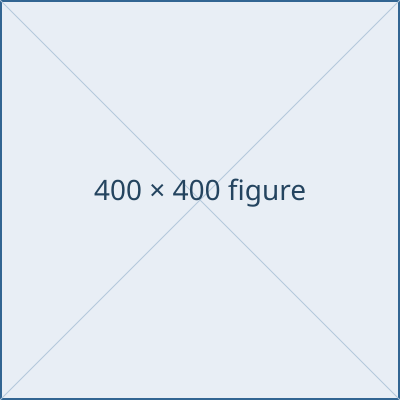

# Control: figure beside text
<!-- _layout: cols 1 1 -->
::: col

::: caption
Figure caption
:::
:::
::: col
Text in its own panel.

- First interpretation
- Second interpretation
:::

---

# Image and bullets in one panel
<!-- _layout: cols 1 1 -->
::: col

- This text should appear below the image.
- Both are ordinary Markdown inside one panel.
:::
::: col
The other panel.
:::

---

# A paragraph between panels
<!-- _layout: cols 1 1 -->
::: col

:::

Shared note between two panels.

::: col

:::

---

# Grid reference with three lines
<!-- _layout: grid 2x2 -->
::: col 1,1

::: caption
Top-left figure
:::
::: ref
First reference line. Second reference line. Third reference line.
:::
:::
::: col 1,2

::: caption
Top-right figure
:::
:::
::: col 2,1

::: caption
Bottom-left figure
:::
::: ref
First reference line. Second reference line. Third reference line.
:::
:::
::: col 2,2

::: caption
Bottom-right figure
:::
:::

---

# A heading

## A normal Markdown subheading

The subheading should follow the heading.

---

# A deliberately long title that needs two lines when describing a detailed comparison between several measurements
<!-- _layout: cols 1 1 -->
::: col
The content begins here, inside the fixed body area.
:::
::: col
Second panel.
:::

---

# Grid placement with whitespace
<!-- _layout: grid 2x2 -->
::: col 2, 1
Place this panel at row 2, column 1.
:::

---

# Grid placement without whitespace
<!-- _layout: grid 2x2 -->
::: col 2,1
Place this panel at row 2, column 1.
:::

---

# Placement beyond the declared grid
<!-- _layout: grid 2x2 -->
::: col 3,1
Row 3 does not exist in the declared 2x2 grid.
:::

---

# Explicit image width
<!-- _layout: cols 1 1 -->
::: col

::: caption
Requested width: 200px
:::
:::
::: col

::: caption
Default full panel width
:::
:::

---

# Longer outer fences
<!-- _layout: cols 1 1 -->
:::: col

::: caption
Caption naturally nested inside a four-colon outer fence.
:::
::: ref
Reference naturally nested inside the same panel.
:::
::::
:::: col
Text in the second panel.
::::
